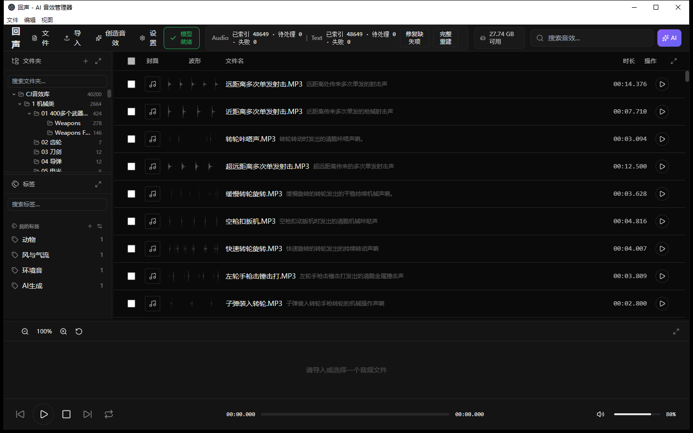
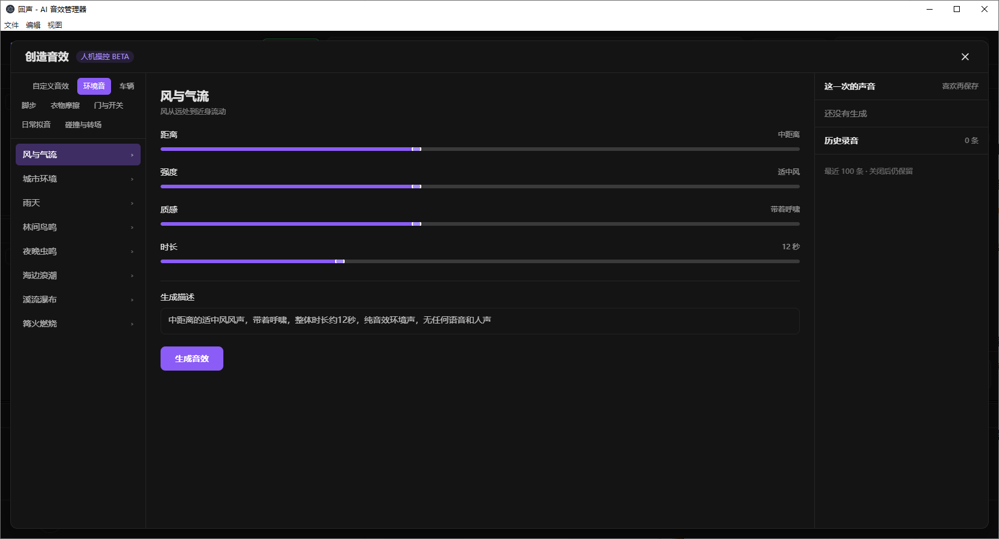
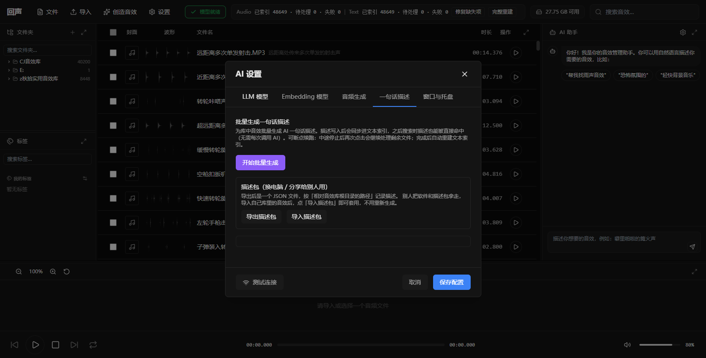
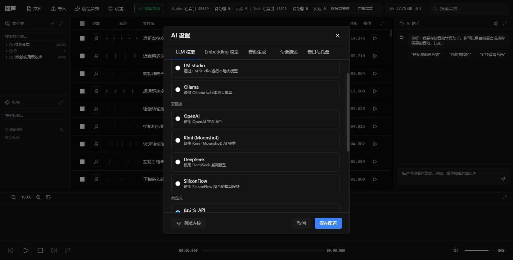

# 🎵 回声 EchoMind - AI Sound Effect Manager

[](https://www.gnu.org/licenses/gpl-3.0)
[](https://github.com/Bastzber/EchoMind/releases/tag/v0.3.0-beta.6)
[](https://www.python.org/)
[](https://www.electronjs.org/)

[中文](README.md) · [Changelog](CHANGELOG.md) · [Releases](https://github.com/Bastzber/EchoMind/releases) · [GPL-3.0-or-later](LICENSE)

> ## Find it, or make it.
>
> Describe the sound you want: **if it's in your library, it shows up in 0.3 s; if it isn't, generate it on the spot.**
>
> A local-first, AI-powered desktop sound-effect manager.

**Current version: `v0.3.0-beta.6` (Test build V6) · Windows x64** · [Release page](https://github.com/Bastzber/EchoMind/releases/tag/v0.3.0-beta.6)

> **This repository is a modified fork of [SoundBot](https://github.com/Huckrick/SoundBot)** (original author Nagisa_Huckrick, GPL-3.0-or-later).
> The license and attribution are preserved. See [Differences from upstream](#differences-from-upstream) for what changed.

Electron provides the desktop UI. A local backend built with FastAPI, SQLite, PyAV and Chroma is frozen into the app, and covers importing, real waveforms, playback, tags, per-project isolation, dual-index retrieval, an AI assistant, and “sound creation” from a one-sentence description.

***

## 📥 Download

| Asset | Notes | Where |
| --- | --- | --- |
| **Full installer** (3.27 GB) | Unzip and run | [Baidu Netdisk](https://pan.baidu.com/s/1vsO7MXvp0kXS-odz2XAcAA?pwd=gbmi)　code: `gbmi` |
| One-sentence description pack | Bundled in the installer root | `win-unpacked\EchoMind-描述包.json` |

> The installer is 3.27 GB, above GitHub's 2 GB per-asset limit, so it is distributed via Baidu Netdisk; the [Releases](https://github.com/Bastzber/EchoMind/releases) page only carries release notes.
>
> Unzip, then run `win-unpacked\EchoMind.exe`. The first launch loads the CLAP model (30–60 s) and indexes your library.

***

## 🖼️ Screenshots

**Main window: folder tree + AI descriptions + waveform**



**Generate a new sound effect from a sentence**



**Batch AI descriptions, with a portable description pack**



**Works with DeepSeek / Kimi / OpenAI / local models**



***

## ✨ What it does

| Capability | Behaviour in v0.3.0-beta.6 |
| --- | --- |
| Import | Native file/folder picker through a minimal IPC bridge, plus drag-and-drop of folders or audio files onto the window |
| Waveforms | 2,000 finite peaks per file fetched on demand; invalidated when the source or algorithm changes |
| Playback | Chromium-playable formats play directly; other containers are transcoded to fingerprinted temporary WAV |
| Projects | SQLite v3 is the single source of truth; files and indexes are isolated per `project_id` |
| Dual index | CLAP audio embeddings for the sound itself, plus a separate text-metadata index for filenames, folders, tags, UCS categories and descriptions |
| Search | Weighted merge of audio 0.55 / text 0.30 / keyword 0.15, with unavailable branches re-normalised |
| Fast channel | Keyword layer only, **60–300 ms**; semantic results are appended in the background |
| AI descriptions | One short Chinese description per file generated by an LLM, written into the text index; resumable batch jobs |
| Description pack | Export/import descriptions keyed by path relative to the library root, so a new drive or machine does not need regeneration |
| Sound creation | Pick a category, drag distance / intensity / texture / duration, get a Chinese prompt, then synthesise a new sound |
| AI assistant | Local or OpenAI-compatible LLM; falls back to the raw local query when the model is unavailable |
| Privacy | No cloud telemetry; external LLM/embedding providers only see text you explicitly send |

***

## 🚀 Quick start

1. Unzip the installer anywhere with ~5 GB free.
2. Run `win-unpacked\EchoMind.exe`.
3. Wait for the top status bar to show `Audio … 0 failed | Text … 0 failed`.
4. Import a folder (button or drag-and-drop).
5. Optionally set an LLM in **设置 → LLM 模型** (DeepSeek, Kimi, OpenAI or a local server).
6. Search: type a keyword (instant) or describe the sound (semantic results arrive a few seconds later).

***

## 🧠 How retrieval works

- **Keyword layer** — filename, path, tags, AI description. Runs in-process against a cached SQLite snapshot.
  Expansion terms are tiered: the original query keeps full weight, its own tokens are capped at 0.65, dictionary synonyms at 0.40.
- **Semantic layer** — CLAP audio embeddings; Chinese queries are translated through a local 150-entry lexicon because the CLAP text tower is English-centric.
- **Text layer** — CLAP text embeddings over the metadata index, which now contains the generated descriptions.
- **Merge** — weights above; the UI shows keyword results first and appends semantic ones without reordering what you already see.

***

## ⚠️ Known limitations

- Semantic search takes 8–14 s per new query (mitigated by the two-phase UI).
- The first search within ~20 s of launch waits for the searcher warm-up.
- The installer is Windows x64 only; macOS builds are not produced by this repository.
- Description matching relies on folder structure and filenames; renamed files fall back to filename matching.

***

## 🔐 Secrets and privacy

- API keys live in the OS credential store (`%APPDATA%\EchoMind\secure_secrets.json`), never in the repository.
- `.env*`, `models/`, `dist*/` and user databases are git-ignored.
- No telemetry. Audio never leaves the machine; only text you explicitly send reaches an external LLM.

***

## 🛠️ Development

```bash
git clone https://github.com/Bastzber/EchoMind.git
cd EchoMind
python -m venv .venv && .venv\Scripts\activate
pip install -r requirements.txt        # backend
npm install                            # Electron shell
python scripts/build.py                # full build (PyInstaller + electron-builder)
python -m pytest                       # tests: testpaths configured in pytest.ini
```

***

## Differences from upstream

**Indexing**

- Fixed the packaged mel worker being started as a second HTTP server, which made every audio embedding fail (15,226 false failures).
- Poison-file blacklist moved to the user data directory, requires two strikes, expires after 3 days and is capped.
- Removed 1,565 permanently unindexable records (missing or undecodable sources).

**Retrieval**

- Searcher cached per project + collection (was rebuilt on every request, 7–13 s each).
- Query cache made cross-instance and no longer keyed by text revision (it could never hit).
- Keyword layer precomputes haystacks and cheap prefilters (0.64 s → 0.05 s).
- Tiered expansion scoring — fixes unrelated files such as `DRIP.wav` outranking real rain sounds.
- Local Chinese→English lexicon for CLAP text queries (150 entries).
- Fast keyword channel with background semantic append.

**Features**

- Folder tree built from full-library statistics, click-to-list with infinite scrolling.
- Drag-and-drop import for folders and files.
- Portable description pack (export/import, relative-path matching, automatic text reindex).
- Batch description generation with resumable jobs and validation against reasoning-model output.

***

## ⚖️ Sound assets

**Neither this repository nor the installer contains any audio files.** The repo has 0 audio files; the 3.27 GB installer has 0 as well — only the app, models and UI.

- The software only manages and indexes your library; **copyright in the audio belongs to its respective owners** and is unrelated to this project's GPL-3.0 license.
- Imported sounds stay on your own disk; the app indexes them locally and never uploads them.
- One-sentence descriptions are produced by the LLM you configure; the description pack contains text only, never audio.
- Sounds produced by "sound creation" are subject to the terms of the text-to-audio service you use.

> ⚠️ If you redistribute audio together with the app (for example a "software + library" bundle), make sure you hold the **redistribution rights** for those assets. Commercial SFX licenses usually forbid redistribution; a disclaimer does not grant you a license.

See [docs/disclaimer.md](docs/disclaimer.md).

## 📄 License

GPL-3.0-or-later. See [LICENSE](LICENSE). The license covers **source code only** — not sound assets and not third-party models.

## 🙏 Credits

Original project: [SoundBot](https://github.com/Huckrick/SoundBot) by Nagisa_Huckrick (胡杨).
